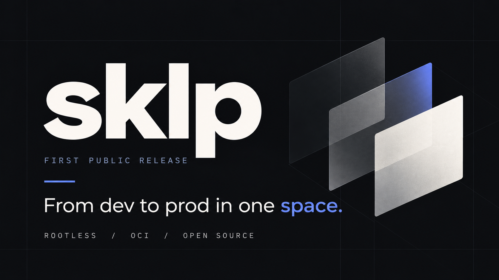

<p align="center"></p>

# sklp

**One contract from your laptop to production. No daemon, no cluster, no YAML sprawl.**

`sklp` is a single static binary that runs your repo's dev stack, CI pipelines and
production deployments from a handful of declarative files under `.sklp/`. Its
node-side twin, `sklet`, turns any Linux VM into a deployment target that
reconciles itself from Git.

Both are built from Linux primitives, not wrapped around a container engine:
user namespaces, `runc`, overlayfs, cgroups v2, netlink, WireGuard. Everything
runs rootless.

```sh
curl -fsSL https://raw.githubusercontent.com/lalternativefabrique/sklp/main/install/sklp.sh | sh
```

## Why

The modern dev loop is three different worlds: Docker Compose on the laptop,
a hosted CI with its own YAML dialect, and a Kubernetes cluster that needs a
team to feed it. Each world has its own notion of a service, a secret, an
image and an environment. Nothing you learn in one transfers to the next.

`sklp` collapses them into one model:

- a **service** is a container type: image, command, ports, env, readiness
- a **space** is an isolated group of services brought up and torn down as one
- a **stack** is a directory under `.sklp/<stack>/` holding the contracts for one deployable thing
- a **pipeline** is a list of steps scoped to the paths they care about

The same `deploy.yaml` runs on your machine with `sklp deploy` and on a node
with `sklet`. The same `space.yaml` that builds the CI runner builds the shell
you develop in.

## What you get

| Verb | What it does |
|---|---|
| `sklp init` | Detects your repo and your AI assistant, writes a baseline `.sklp/` and repo-tailored skills |
| `sklp dev <stack>` | Supervises the local dev stack from `.sklp/<stack>/dev.yaml`: ordering, readiness, logs, one Ctrl-C to stop |
| `sklp run <pipeline>` | Runs `.sklp/pipelines/<name>.yaml` locally in a space, only the steps whose scope the diff touches |
| `sklp space up <name>` | Builds a closed environment from `.sklp/space.yaml` (base image, toolchains, packages) and drops you in |
| `sklp deploy apply <stack>` | Applies `.sklp/<stack>/deploy.yaml` to a node, local or remote, over TLS with a bearer token |
| `sklp deploy ls / logs / exec` | Pilots a running node from your workstation. No SSH needed |
| `sklet reconcile` | On the node: polls Git, applies what it declares, rolls out, soaks, rolls back |
| `sklet upgrade` | Replaces itself from the published build, health-checks, rolls back if it does not stay up |

## How it works

`sklp` embeds an OCI runtime. There is no daemon to install and nothing runs
as root.

- **Rootless by construction.** Every space owns a user namespace carved from
  the operator's subuid range. A container's root is a subuid of its space, so
  two spaces on one host cannot see each other's files or signal each other's
  processes.
- **Real resource limits.** Each service lands in its own cgroup v2 leaf with
  `pids.max`, `memory.max` and `cpu.max` applied before the first fork.
- **Immutable images, writable overlays.** Image layers are a shared read-only
  content-addressed store. Each service gets a private overlayfs upper that is
  discarded when the image changes.
- **A network per space.** A dedicated bridge and netns, internal DNS
  (`<service>.<space>.internal`), nftables egress policy, and host exposure only
  for what the manifest declares.
- **Nodes talk over a mesh.** `sklet` nodes join a WireGuard mesh with an
  admission authority. Public ingress is one node fronting the rest, with
  per-host TLS and SNI relays.
- **Rollouts that watch themselves.** A new image is soaked before it becomes
  the pinned one; a service that does not stay healthy is rolled back to the
  previous digest.
- **Restores you can prove.** A node derives a restore space from the
  production manifest and drills it against the real backup, so a backup that
  cannot be restored is a failed check, not a surprise.

## Contracts

```yaml
# .sklp/api/deploy.yaml
version: 1
kind: deploy
name: api

services:
  postgres:
    image: postgres:17
    port: 5432
    env:
      POSTGRES_PASSWORD: ${POSTGRES_PASSWORD}
    volumes:
      - api-pg:/var/lib/postgresql/data
    ready:
      log: "database system is ready to accept connections"

  api:
    image: ghcr.io/acme/api:2026.10.26
    port: 8080
    depends_on: [migrate]
    resources:
      cpu: "500m"
      memory: 512M
    ready:
      http: /health

jobs:
  migrate:
    image: ghcr.io/acme/api-migrate:2026.10.26
    depends_on: [postgres]

gateway:
  routes:
    - host: api.acme.example
      service: api
```

Services are reachable by name inside the space and nowhere else. A `jobs:`
entry runs once to completion, or on a cron `schedule:`. Only a `gateway`
route puts a service on the public side, with TLS from the shared front door.

```yaml
# .sklp/pipelines/ci.yaml
version: 1
kind: pipeline
name: ci

tools:
  go: "1.26.6"

scopes:
  api: ["apps/api/**"]

steps:
  - name: test
    scope: [api]
    tools: [go]
    run: go test ./apps/api/...
```

Secrets never live in a contract. They are referenced as `${NAME}`, resolved
from an encrypted stack config or the node's sealed environment, and passed to
the process without touching disk in clear.

## Install

**Workstation** (Linux, or macOS for the CLI verbs):

```sh
curl -fsSL https://raw.githubusercontent.com/lalternativefabrique/sklp/main/install/sklp.sh | sh
```

**Node** (Linux VM, no root after the one-time host setup):

```sh
curl -fsSL https://raw.githubusercontent.com/lalternativefabrique/sklp/main/install/sklet.sh | sh
sudo sklet host setup
sklet apply api --space production --listen :6464
```

Then from your workstation:

```sh
sklp deploy login --context prod --server https://<node>:6464 --token <T> --ca-fingerprint <FP> --space production
sklp deploy apply api -context prod
sklp deploy logs api -f
```

## Build from source

```sh
git clone https://github.com/lalternativefabrique/sklp
cd sklp
go generate ./space/embed/      # fetches and checksum-verifies the pinned runc and slirp4netns
go build -o ~/.local/bin/sklp ./cmd/sklp
go build -o ~/.local/bin/sklet ./cmd/sklet
```

`scripts/build-cli-binaries.sh` produces the static release binaries for
linux/amd64, linux/arm64 and darwin.

## Requirements

- Linux with cgroups v2 and user namespaces (any current Ubuntu, Debian, Fedora, Arch)
- `uidmap` (`newuidmap` / `newgidmap`) for rootless spaces
- `systemd --user` with `cpu memory pids` delegated for resource limits

`sklet host setup` configures all of this on a fresh VM.

## Status

`sklp` and `sklet` run the production of the company that builds them, on a
fleet of plain VMs, with no Kubernetes anywhere. The contracts are stable; the
control API and the mesh are still evolving. Expect sharp edges in places that
only one fleet has exercised, and please report them.

## Contributing

Issues and pull requests are welcome. The code follows one rule above all:
the code is the only source of truth, so comments are rare and every
behaviour has a test. Run `go vet ./...` and `go test ./...` before opening a
PR.

## License

sklp is source-available under the [Business Source License 1.1](LICENSE).
You may use it in production, including internally within your organisation,
but you may not offer it to third parties as a hosted or embedded product that
competes with the Licensor's paid versions. Each version converts to the
Apache License 2.0 four years after its publication.

Contributions are accepted by pull request only, under the
[Contributor License Agreement](CLA.md). See [CONTRIBUTING.md](CONTRIBUTING.md).

For commercial licensing: contact@skalpai.dev
